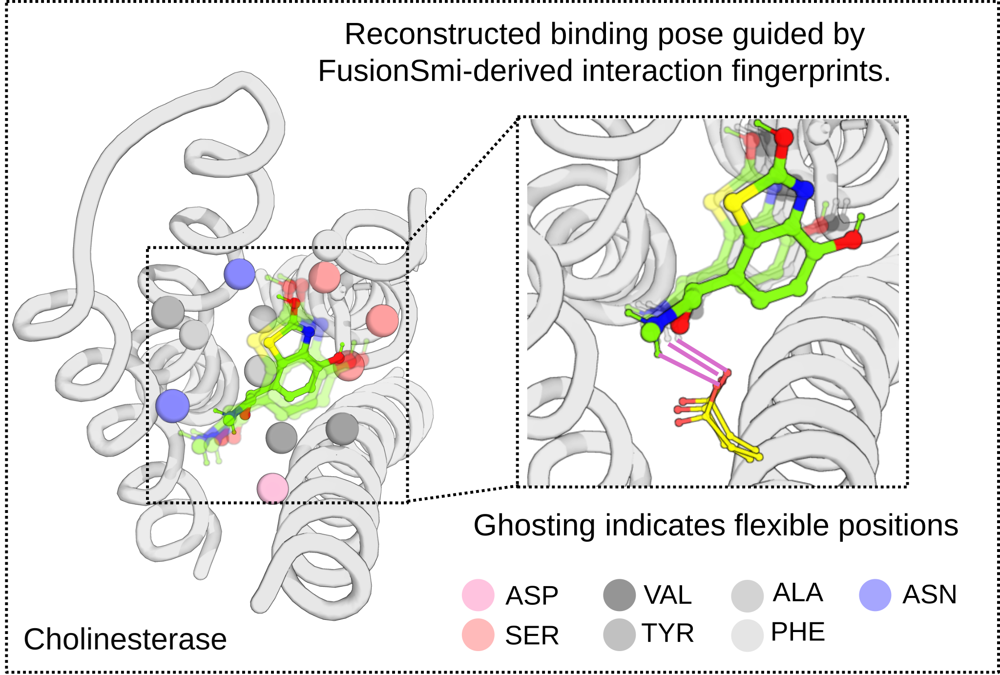
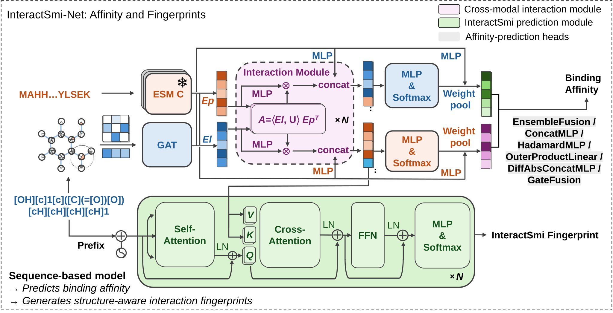

# InteractSmi
**Learning the Language of Protein–Ligand Interactions**

[](https://colab.research.google.com/github/jinlong-abc/InteractSmi_Net/blob/master/InteractSmi_Net_Demo.ipynb) 

InteractSmi is a sequence-based fingerprint for encoding protein–ligand interactions into a compact and interpretable representation. Built on InteractSmi, InteractSmi-Net enables efficient binding-affinity prediction and interaction-pattern inference, even when reference protein or ligand structures are unavailable.


## InteractSmi Fingerprint

InteractSmi encodes protein-ligand interactions into a compact, interpretable sequence. It captures essential biochemical and geometric information, providing a “grammar” for molecular interplay. This fingerprint can be inferred from either the complex structure or separate protein and ligand sequences.

<p align="center">
  
</p>

### Building the fingerprint

The [`fingerprint_construction/`](fingerprint_construction/) directory contains the pipeline that turns a raw PDBBind dataset into InteractSmi fingerprints (proLIF and closest-atoms interaction fingerprints, merged as `prolif_closest` and rendered as AtomIdx fusion sequences). See [`fingerprint_construction/README.md`](fingerprint_construction/README.md) for setup and usage.

---

## InteractSmi-Net Model Architecture

InteractSmi-Net is a sequence-based neural network built on the InteractSmi fingerprint. The model is designed for fast and accurate binding affinity prediction and interaction inference. Its architecture efficiently captures long-range dependencies and spatial interaction patterns while remaining interpretable.

<p align="center">
  
</p>

---

## Environment Setup

Create the environment from the provided `environment.yml`:

```bash
conda env create -f environment.yml
conda activate interactsmi_env
```

PyTorch is installed via pip (bundled CUDA). If you need the CUDA 12.4 build
used in training, run:

```bash
pip install torch==2.6.0 --index-url https://download.pytorch.org/whl/cu124
```

Run the commands one at a time (do not chain them with `&&` on one line).

### Test the Environment

The `test` package lives under `src/`, so run the test from there:

```bash
cd src
python -m test.Test_model_evalue > evalue_log.txt 2>&1
cat evalue_log.txt
```

`> evalue_log.txt 2>&1` captures both stdout and stderr, so the log file is
created even if the command fails. A non-empty log does not mean the test
passed — check that it contains `Predicted affinity:` / `Generated InteractSmi:`
and no traceback (e.g. `No module named`).

## Training

InteractSmi-Net is trained in three stages:

1. **Fingerprint pretraining** on the filtered BindingNet corpus and the PDBbind training subset, *without* affinity supervision.
2. **Fingerprint fine-tuning** on the PDBbind training subset only.
3. **Affinity prediction**, initialized from the stage-2 checkpoint: PDBbind is optimized with a joint affinity + fingerprint loss; ChEMBL uses only the affinity loss with the fingerprint decoder frozen.

First build the InteractSmi fingerprints for your data with [`fingerprint_construction/`](fingerprint_construction/) (see above), then prepare the ESMC protein embeddings and the CSV/HDF5 inputs. Run the training from `src/`:

```bash
# Stage 1 -- fingerprint pretraining (no affinity supervision)
python -m model.train --stage 1 --affinity_weight 0.0 --sequence_weight 1.0 \
    --train_csv_data_path /path/to/train.csv --test_csv_data_path /path/to/test.csv \
    --train_dataset_path /path/to/train.h5 --test_dataset_path /path/to/test.h5 \
    --prot_esmc_embed /path/to/esmc.pkl --vocab /path/to/vocab.pkl

# Stage 2 -- fingerprint fine-tuning (PDBbind train only)
python -m model.train --stage 2 --affinity_weight 0.0 --sequence_weight 1.0 \
    --finetune_from <stage1>/dev_best_models/best_model.pt \
    ... (same data arguments)

# Stage 3 -- affinity prediction
# PDBbind: joint affinity + fingerprint
python -m model.train --stage 3 --task pdbbind --affinity_weight 1.0 --sequence_weight 0.1 \
    --finetune_from <stage2>/dev_best_models/best_model.pt ...

# ChEMBL: affinity only, frozen decoder
python -m model.train --stage 3 --task chembl --affinity_weight 1.0 --sequence_weight 0.0 \
    --finetune_from <stage2>/dev_best_models/best_model.pt \
    --freeze_layers '{"transformer_decoder": true, "generator": true, "embedwithpos": true}' ...
```

All paths and hyperparameters are command-line arguments — see [`src/config.py`](src/config.py) for the full list and defaults.

The best checkpoint of each stage is written to `{checkpoint_path}/{name}/dev_best_models/best_model.pt` (selected by the lowest validation loss); pass that path to `--finetune_from` for the next stage.

### Data paths

`train.py` reads the following inputs (all set as `--...` flags in `src/config.py`):

* `--train_csv_data_path` / `--test_csv_data_path` — CSV with the columns `ID, UniProt, Assay Result, pInteraction, Normal SMILES, SMILES, FusionSmi, Mapped_SMILES, IntSeq, Sequence`. Build it from raw PDBBind with `fingerprint_construction/` (its `Fusion_SMILES` / `IntSeq` outputs are the `FusionSmi` / `IntSeq` columns here).
* `--train_dataset_path` / `--test_dataset_path` — HDF5 datasets produced from the CSV by `src/data/data_processor.py` on the first run.
* `--prot_esmc_embed` — precomputed ESMC protein embeddings (pickle mapping UniProt id → embedding; expected embedding dim 1152).
* `--vocab` — tokenizer vocabulary for the fusion-sequence tokens.
* `--dict_prefix` — prefix of the `atom_dict.pkl` / `bond_dict.pkl` / `fingerprint_dict.pkl` files.

---

## Dependencies

* Python 3.9
* CUDA 12.4 required for PyTorch GPU support
* Main dependencies include:

  * `pytorch-cuda`
  * `torchvision`, `torchaudio`
  * `ipykernel`
  * `pymol-open-source`
  * `openbabel`
  * `rdkit`

Check the log file if there are any errors during execution.

---

## Datasets

The datasets used in this study are publicly accessible from the following sources:

* **PDBbind v2020**: Available at the [PDBbind database](https://www.pdbbind-plus.org.cn/download).  
* **BindingNet**: Deposited in Zenodo, including Crystal Templates, High-confidence, Moderate-confidence, and Low-confidence subsets. Access via [BindingNet on Zenodo](https://zenodo.org/records/11218293).  
* **BindingDB**: Available from the [BindingDB repository](https://www.bindingdb.org/rwd/bind/index.jsp).

---

## Features

* High-fidelity protein-ligand fingerprinting
* Sequence-based model, no need for reference structures
* Fast training and inference (~10x speedup compared to complex-based methods)
* Interpretable binding pattern predictions
* Supports reverse target fishing applications

---

## License
This project is licensed under the GNU Affero General Public License v3.0 (AGPL-3.0). See LICENSE file for details.
